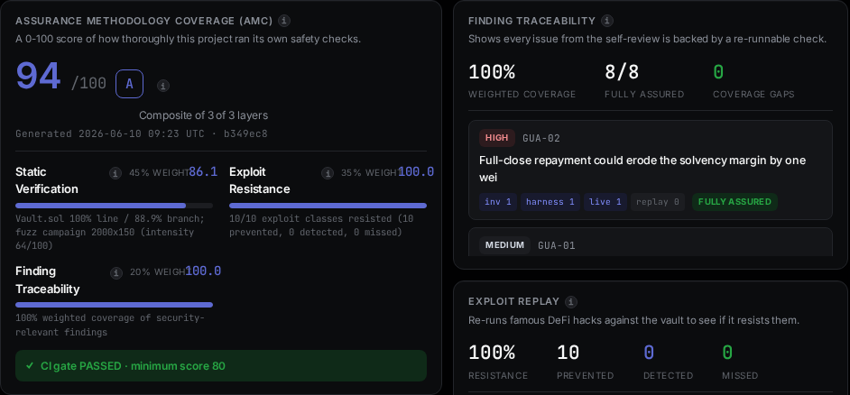

# Guardian Pipeline: 12 lending-vault invariants checked in CI and by a runtime monitor

[](https://github.com/RahilBhavan/guardian-pipeline/actions/workflows/invariant-ci.yml)
[](LICENSE)

**Dashboard:** https://guardian.rahilbhavan.com (live data from the scheduled monitor, see [Scope and limits](#scope-and-limits))



Guardian Pipeline is a Solidity lending vault with 12 safety invariants. A Foundry invariant harness tests the invariants in CI before deployment. A TypeScript monitor re-checks the same 12 invariants against a demo vault on Base Sepolia, a test network that holds no real value, and writes violations to Supabase for a React dashboard. The hosted monitor runs on a best-effort ~5-minute GitHub Actions schedule; the hosted dashboard reads its results live. An assurance layer replays 10 exploit classes, traces each self-review finding to a test, and computes a methodology score that CI gates on.

## Results

- **99 Foundry tests** in `test/`: 39 unit and boundary, 8 parameterized fuzz, 14 invariant (the 12 named invariants, a reentrancy check for finding GUA-01 and a share-price monotonicity check), 9 differential, 10 exploit replays, 13 mutation tests and 6 invariant-kit tests. The mutation tests break the vault on purpose for INV-07 to INV-12 and assert that the matching invariant catches each break.
- **The invariants are reusable.** The vault-agnostic invariants live in `test/kit/` behind an adapter interface, and the harness reads this vault through `GuardianVaultAdapter`. [test/kit/README.md](test/kit/README.md) describes how to point them at another lending vault, with Revert's `V4Vault` and Morpho Blue as examples. Those two adapters are not written yet.
- **12 invariants** (INV-01 to INV-12). CI runs them as a 2,000-run invariant campaign at depth 150 on every push and pull request to `main` (`foundry.toml`, `[profile.ci.invariant]`). A scheduled 10,000-run profile is in `.github/workflows/deep-fuzz.yml`. Plain fuzz tests use 256 runs.
- **The solvency invariant (INV-01) caught a real bug during development.** A full-close repayment eroded the solvency margin by one wei. The self-review records it as GUA-02, High, Resolved (`security-review/findings.json`).
- **The runtime monitor mirrors all 12 invariants.** `guardian/src/evaluator.ts` has one check per invariant, and the `mirror-parity` CI job fails if the monitor and the harness drift apart.
- **`src/Vault.sol` has 100% line coverage** (130 of 130 lines, 28 of 31 branches), observed with `forge coverage` on 2026-10-21. CI fails below 85% line coverage.
- **The self-review lists 8 findings**, GUA-01 to GUA-08: 3 resolved and 5 acknowledged (`security-review/findings.json`).
- **The Assurance Methodology Coverage (AMC) score was 94/100 (grade A)** on 2026-10-24 at commit `d992265`, regenerated from a CI-profile fuzz run and `forge coverage` (`assurance/data/assurance-report.json`). AMC measures how fully the project applied its own verification method. It is self-graded and is not a security rating. See [docs/assurance.md](docs/assurance.md).

The two sentences below are generated from `security-review/findings.json` and `assurance/data/exploit-replays.json`. The `invariant-ci` workflow fails if they drift.

<!-- TRACEABILITY_BEGIN -->

**Finding traceability:** 8/8 security-relevant findings fully assured · 0 monitored-only · 0 harness-only · 0 gap · 100.0% weighted coverage.

<!-- TRACEABILITY_END -->

<!-- EXPLOIT_SUMMARY_BEGIN -->

**10 mechanism replays, 10 PREVENTED, 0 MISSED.**

<!-- EXPLOIT_SUMMARY_END -->

## How it works

1. `src/Vault.sol` is an interest-bearing, over-collateralised, two-asset lending vault. Lenders supply the debt asset. Borrowers post a separate collateral asset that an `IPriceOracle` prices. The demo uses `src/MockOracle.sol`.
2. `test/invariant/InvariantVault.t.sol` drives the vault through random call sequences with eight handlers and asserts the 12 invariants after each call.
3. `guardian/src/evaluator.ts` evaluates the same 12 invariants against live vault state. `guardian/src/bot.ts` runs it once per block. `guardian/src/once.ts` runs it once, from the scheduled workflow `.github/workflows/guardian-monitor.yml`. Violations go to Supabase (`supabase/migrations/`).
4. `dashboard/` is a React 18 and Vite app. With a live backend (`VITE_GUARDIAN_LIVE=true` and the Supabase variables) it reads Supabase. Without one it renders `dashboard/src/data/recorded-run.json` under a "Recorded run — live monitor offline" banner. The hosted build reads the public Supabase URL, publishable key and live flag from the committed `dashboard/.env.production`. Vercel builds it from `vercel.json`.
5. `assurance/` computes the AMC score from coverage, the exploit replays in `test/exploit/` and the finding bindings in `security-review/findings.json`.
6. `.github/workflows/invariant-ci.yml` runs 9 jobs: build, mirror parity, invariant fuzz, coverage, static analysis (Slither and Aderyn), assurance, gas snapshot, Guardian operational tests and the invariant kit. The job table is in [docs/architecture.md](docs/architecture.md#ci-jobs).

## Run it

You need [Foundry](https://getfoundry.sh/) (checked with forge 1.8.6) and Node.js 20 or later. The `guardian/` monitor needs Node.js 22 or later. The contracts and both TypeScript test suites need no external services.

```bash
git clone https://github.com/RahilBhavan/guardian-pipeline
cd guardian-pipeline
forge install
forge test
cd assurance && npm install && npm test && cd ..
cd guardian && npm install && npm test && cd ..
```

Observed on 2026-10-24 with forge 1.8.6 and Node.js 26.8.1:

- `forge test` passed all 99 test functions. Forge prints "86 tests" because it reports the 14 `invariant_*` functions of `InvariantVault` as one suite entry. Each of the 14 prints its own `[PASS]` line.
- `assurance`: 50 of 50 tests passed.
- `guardian`: 66 of 66 tests passed.

To run the invariant campaign with the CI profile (2,000 runs, depth 150). On 2026-10-24 all 14 invariant functions passed in 271 s, and the corpus-coverage gate showed every handler selector firing at least 18,573 times. Reading the vault through the kit adapter costs time: the same campaign on `main` before the kit took 137 s on the same machine:

```bash
FOUNDRY_PROFILE=ci forge test --match-contract InvariantVault -vvv
```

Running your own monitor needs an Alchemy key and your own Supabase project. Without them, `dashboard/` builds and shows the recorded run (`cd dashboard && npm ci && npm run build`). The monitor reads `ALCHEMY_KEY`, `VAULT_ADDRESS`, `DEBT_ASSET`, `SUPABASE_URL` and `SUPABASE_SERVICE_KEY`. The scheduled `once.ts` runner instead requires server-side `DATABASE_URL`, `VAULT_DEPLOY_BLOCK` and `ALCHEMY_KEY` (or `RPC_URL`); see [operations](docs/operations.md) before enabling it. The dashboard reads `VITE_SUPABASE_URL` and `VITE_SUPABASE_ANON_KEY`. Deployment, keystore setup and the staged detection demo are in [docs/setup.md](docs/setup.md). The public demo addresses are in [demo/README.md](demo/README.md).

## Repository layout

- `src/`: Solidity: `Vault`, `AttackableVault` (demo-only), the oracle interface and mocks, and `attackable/` exploit targets.
- `test/`: Foundry unit, fuzz, invariant, differential, exploit-replay, mutation and Echidna tests, and the reusable invariant kit in `test/kit/`.
- `script/`: Foundry scripts for deployment and the exploit-replay catalogue.
- `scripts/`: demo address lookup and the staged detection demo.
- `security-review/`: the self-conducted review and its machine-readable findings.
- `assurance/`: the Node.js tool that computes the AMC score and checks traceability.
- `guardian/`: the TypeScript runtime monitor (viem).
- `dashboard/`: the React and Vite monitoring dashboard.
- `supabase/`: database migrations and row-level security policies.
- `demo/`: public Base Sepolia addresses.
- `docs/`: reference and explanation pages.
- `.github/workflows/`: CI, the deep fuzz, the scheduled monitor and the oracle keeper.
- `AGENTS.md`, `CLAUDE.md`: agent workflow files for the author's coding agents. They are not needed to build or run the project.

## Documentation

- [docs/README.md](docs/README.md): index of the pages below.
- [docs/assurance.md](docs/assurance.md): the AMC score, the exploit replays, finding traceability and what the score does not measure.
- [docs/architecture.md](docs/architecture.md): the four layers, how state flows between them and the CI job table.
- [docs/invariants.md](docs/invariants.md): each invariant's formula, class and failure mode, and the test tiers.
- [docs/contracts.md](docs/contracts.md): the Solidity API.
- [docs/guardian-bot.md](docs/guardian-bot.md): the runtime monitor, module by module, and its environment variables.
- [docs/database.md](docs/database.md): the Supabase schema, row-level security and migrations.
- [docs/setup.md](docs/setup.md): local setup, Base Sepolia deployment and the staged demo.
- [docs/glossary.md](docs/glossary.md): project identifiers and terms.
- [docs/explainer.html](docs/explainer.html): an interactive explainer page.

## Scope and limits

- This is an independent portfolio and research demo. It is not production code and has no affiliation with Base, Coinbase or any protocol named in the exploit replays.
- `Vault.sol` is a teaching example. It uses a permissionless `MockOracle`, has no bad-debt reserve and has no governance. Do not use it to hold real value. See [SECURITY.md](SECURITY.md).
- The security review is a self-review by the repository author, not a third-party audit.
- The AMC score is self-graded. The same author writes the invariants, picks the exploit set, binds the findings and grades the result.
- Fuzzing does not prove the invariants. No Certora or Halmos proof exists. See [docs/invariants.md](docs/invariants.md#formal-verification--a-known-gap).
- **The scheduled monitor checks the shared demo vault every ~5 minutes** (restored 2026-10-27, issue #47). Each run checks the latest block, not every block. INV-11 fails on every run because the demo oracle's price is stale until a funded keeper refreshes it. GitHub ran the workflow's own `*/5` schedule only every 3 to 4 hours, so a Supabase `pg_cron` job (`supabase/migrations/0005_monitor_dispatch_cron.sql`) now starts it every 5 minutes through GitHub's workflow-dispatch API, and each run catches up toward the chain head for up to 5 minutes. The dashboard shows GUARDIAN DOWN whenever more than 7 minutes pass without a checked block, which still happens when GitHub queues or delays a run.
- **Without a live backend the dashboard shows a recorded run.** `scripts/record-demo-run.sh` starts a local anvil chain, deploys the demo contracts, plays a scripted scenario (deposit, borrow, one day of interest, a price fall with a partial liquidation, then `AttackableVault.attack()`) and replays the repo's own fetcher and evaluator over each of the 16 blocks. The result is committed as `dashboard/src/data/recorded-run.json`: 16 blocks, 3 alerts (INV-01 and INV-07 at the breach block, INV-01 again on the next block), recorded on 2026-10-24. The chain is local, not Base Sepolia. The latencies are local-RPC timings. The assurance panels are separate build-time CI reports.
- `guardian/src/once.ts` and `bot.ts` remain a best-effort reference implementation, not a service with an uptime promise. `guardian-monitor.yml` is started every 5 minutes by `pg_cron`, with its own `*/5` schedule as a fallback; GitHub may still queue or delay runs.
- The staged demo is not an exploit. `AttackableVault.attack()` is a demo-only flag that forces an INV-01 violation so you can watch the monitor alert.

## License

MIT. See [LICENSE](LICENSE).

Part of [Rahil Bhavan's projects](https://github.com/RahilBhavan).
