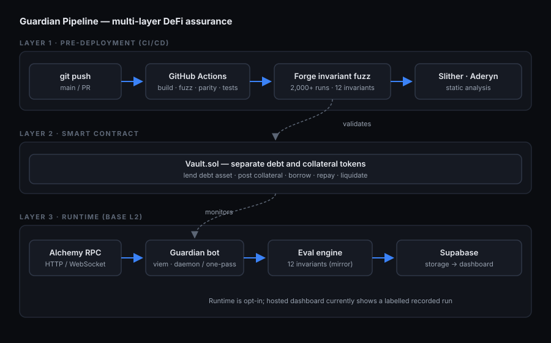

# Architecture

Guardian Pipeline enforces one set of mathematical invariants across the entire
lifecycle of a DeFi protocol — before deployment and after. This document
explains the four layers and how state flows between them.



---

## The core idea

A protocol's safety can be expressed as a set of **invariants** — properties
that must hold in every reachable state (e.g. *the vault can never owe more
than it holds*). Guardian Pipeline writes those invariants **once**, then
enforces the identical definition in two places:

- **Before deployment** — as Foundry `invariant_*` functions, fuzzed against
  hundreds of thousands of randomised call sequences.
- **After deployment** — as a TypeScript evaluator that re-checks the same
  formulas against live on-chain state (every block in the `bot.ts` daemon;
  the latest block per run in the hosted ~5-minute scheduled runner).

`guardian/src/evaluator.ts` is a deliberate 1:1 mirror of
`test/invariant/InvariantVault.t.sol`. If the two ever diverge, the project has
failed its own thesis — so the 12 invariant IDs (`INV-01`…`INV-12`) are shared
verbatim across both.

---

## Layer 1 — Pre-deployment (CI/CD)

**Trigger:** every `push` and `pull_request` to `main`.

Foundry's invariant fuzzer drives the vault through random call sequences via
eight handler contracts (`DepositHandler`, `CollateralHandler`, `BorrowHandler`,
`WarpHandler` — which advances time and accrues interest — `LiquidateHandler`,
`DonationHandler` — which transfers tokens straight to the vault — `OracleHandler`
— which moves the collateral price — and `ReentrancyHandler`) and asserts all 12
invariants after each step.

| Profile | Runs | Depth | Use |
|---------|------|-------|-----|
| `default` | 500 | 100 | Local iteration |
| `ci` | 2,000 | 150 | Every push (up to ~300,000 handler calls) |
| `deep` | 10,000 | 200 | Pre-release |

A green CI badge is a claim: *all 12 invariants held across the campaign — no
`invariant_*` assertion failed.* (Handlers return early on the conditions
where the vault would revert, and `foundry.toml` sets `fail_on_revert = true`,
so every handler call must succeed — see
[invariants.md#testing-strategy](invariants.md#testing-strategy).)

### CI jobs

`.github/workflows/invariant-ci.yml` runs **9 jobs** on every push/PR to `main`:

| Job | What it does | Feeds AMC? |
|-----|--------------|------------|
| `build` | `forge build --sizes`; compiles contracts for dependent jobs | no |
| `mirror-parity` | Asserts every INV-tagged harness `invariant_*` has a paired entry in `guardian/src/evaluator.ts` | no |
| `invariant-fuzz` | 2,000-run invariant campaign; fails on any `[FAIL]` | yes — emits `runs.json` artifact AMC consumes |
| `coverage` | LCOV report; gates `src/Vault.sol` at ≥ 85% line coverage | no — capped runs/depth are coverage-budget only |
| `static-analysis` | Slither + Aderyn, uploaded as artifacts (non-gating) | no |
| `assurance` | Exploit replays + composite Assurance Score; gates at ≥ 80 | yes — computes the score |
| `gas-snapshot` | `forge snapshot --check --no-match-contract '(MorphoBlue\|RevertV4Vault)ForkTest'`; posts the gas diff as a PR comment | no |
| `guardian` | Typecheck, runtime tests, build, and two-process PostgreSQL failover/rollback proof | no |
| `invariant-kit` | Guardian adapter mutant tests; Morpho fork skipped unless an RPC is supplied separately | no |

## Layer 2 — Smart contract

`src/Vault.sol` — an interest-bearing, over-collateralised, **two-asset** lending
vault. Lenders deposit the **debt asset** and receive shares whose value rises as
borrowers pay interest; borrowers post a separate **collateral asset** — priced by
an `IPriceOracle` — and may borrow the debt asset up to 80% of their collateral
value. The accounting is Morpho-style dual-tracked — the lender side stores assets
directly, the borrow side scales an index.

- **State:** `totalSupplyAssets` / `totalSupplyShares` / `userSupplyShares` on the
  lender side; `totalCollateral` / `userCollateral` for posted collateral;
  `totalBorrowShares` / `userBorrowShares` / `borrowIndex` on the borrow side; plus
  `lastAccrualTime`. The two asset addresses, the `oracle`, `collateralRatio`
  (`80_00` bps) and `liquidationBonus` are immutable; `MAX_STALENESS` (1 day)
  gates every oracle price read (INV-11).
- **Mutating functions:** `deposit`, `withdraw`, `depositCollateral`,
  `withdrawCollateral`, `borrow`, `repay`, `liquidate`, and `accrue` — all
  `nonReentrant`. Interest accrues at the start of every call; under-water
  positions are cleared via `liquidate`, which seizes oracle-priced collateral.
- **`attack()`** lives only on `src/AttackableVault.sol`, a demo-only subclass.
  It is a deliberate one-line flag — not an exploit — that inflates
  `totalSupplyAssets` past the assets backing it, breaking INV-01 so the runtime
  monitor can be observed catching it. It is callable only by the `attacker`
  address and reverts on Base mainnet (`block.chainid == 8453`). The reviewed
  `Vault` has no such function.

`src/MockERC20.sol` is a plain 18-decimal test token (`mUSD`) with unrestricted
`mint` — intentionally hook-free, so the harness need not model ERC-777-style
reentrancy.

The full contract API — every function, event, error, and storage slot — is in
[contracts.md](contracts.md).

## Layer 3 — Runtime monitor

`guardian/` — a TypeScript monitor for a deployed vault on Base L2. It runs two
ways from the same fetch → evaluate → route core: as a per-block daemon
(`bot.ts`, ~2 s cadence) for a real host, and as a single-pass check (`once.ts`)
driven by a free, best-effort **scheduled GitHub Actions** job (~5-min cadence)
against the public demo vault. It is a reference implementation, not a hardened
production service. See [operations](operations.md) for the opt-in transactional HA worker and
how the hosted schedule was restored.

```
watchBlockNumber ─▶ fetchVaultState ─▶ evaluateInvariants ─▶ router
   (viem, ~2s)        (1 multicall)        (12 checks)        │
                                                              ├─▶ blocks_checked  (every block)
                                                              └─▶ alerts          (on violation)
```

1. **Poll** — a viem WebSocket client subscribes to new block numbers
   (`BLOCK_POLL_INTERVAL_MS`, default 2,000 ms). A re-entrancy flag skips a
   block if the previous check is still running.
2. **Fetch** — `fetcher.ts` reads the aggregate state and every discovered
   account's per-user position in a single `multicall`. The account set is
   seeded from `Deposited` / `Borrowed` / `Liquidated` events and kept current
   by an incremental scan each block.
3. **Evaluate** — `evaluator.ts` runs the 12 invariant checks against the
   snapshot — nine from the block snapshot, two (INV-07, INV-09) from a delta
   against the prior observation, one (INV-08) from event reconciliation.
   Detection latency is `Date.now()` before fetch vs. after evaluate.
4. **Route** — `router.ts` writes one `blocks_checked` row per block (liveness
   + latency history) and one `alerts` row per violation. Database failures are
   logged and swallowed — a monitor must never crash on its own alert path.

The bot requires the Supabase **service-role** key: RLS denies inserts to the
public anon key, so only the server-side bot can write.

Module-by-module detail is in [guardian-bot.md](guardian-bot.md); the schema it
writes to is in [database.md](database.md).

## Layer 4 — Assurance

The assurance layer rolls the pre-deployment evidence into a single number — the
**Assurance Score** (0–100) — recomputed on every commit by the `assurance` CI
job. It backtests 10 historical exploit classes, traces 8 security-review
findings to the layers that cover them, and gates CI at a minimum score of 80.
Full detail in [assurance.md](assurance.md).

---

## Data flow at a glance

```
git push ──▶ GitHub Actions ──▶ Forge fuzz + Slither/Aderyn + Assurance Score
                                          │ validates
                            Vault.sol (build target: Base Sepolia)
                                          │ monitored, when run, by
        Alchemy RPC ──▶ Runtime monitor ──▶ Supabase ──▶ React dashboard
                                                         (real-time)
```

| Component | Reads from | Writes to |
|-----------|-----------|-----------|
| Runtime monitor (scheduled, ~5 min) | Base L2 (via Alchemy) | Supabase `alerts`, `blocks_checked` |
| Dashboard | Supabase (anon key, real-time) | — |
| CI assurance job | Forge output, `security-review/findings.json` | `assurance/data/*` |

---

## Related documents

- [invariants.md](invariants.md) — the 12 invariants in full
- [contracts.md](contracts.md) — the `Vault` / `AttackableVault` / `MockERC20` API reference
- [guardian-bot.md](guardian-bot.md) — the off-chain bot, module by module
- [database.md](database.md) — the Supabase schema and RLS model
- [invariants.md#testing-strategy](invariants.md#testing-strategy) — the seven test tiers
- [CI jobs](#ci-jobs) — the nine-job CI/CD pipeline summary
- [assurance.md](assurance.md) — the Assurance Score and exploit replays
- [setup.md](setup.md) — running every layer locally
- [glossary.md](glossary.md) — terminology
